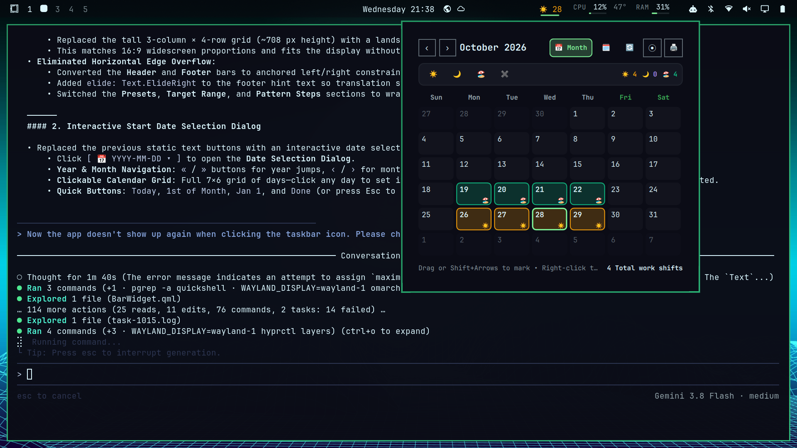
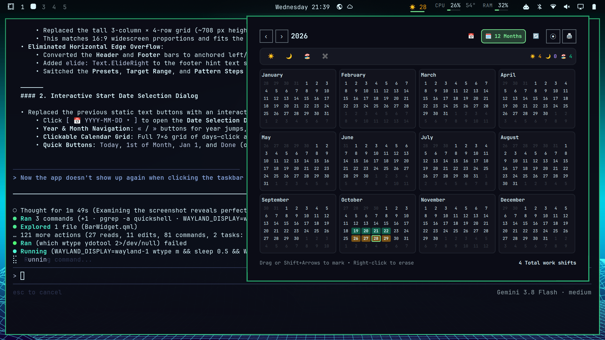
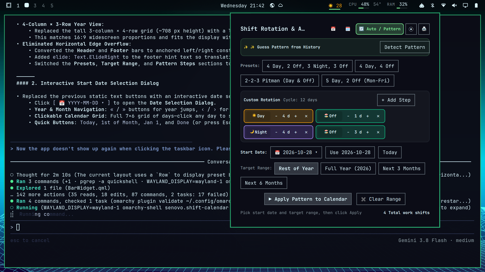
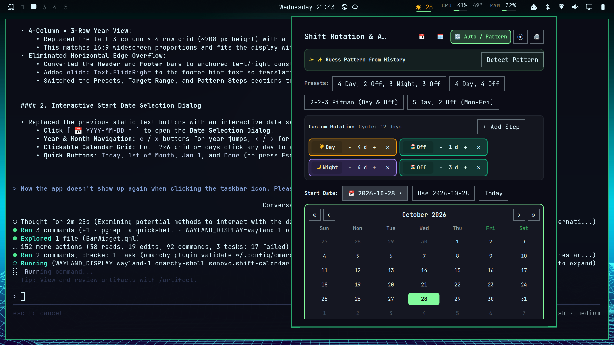

# 📅 Omarchy Shift Calendar

An interactive, multilingual work shift calendar widget and keyboard-driven popup designed for the [Omarchy](https://github.com/basecamp/omarchy) desktop shell.

Effortlessly track **Day Shifts**, **Night Shifts**, and **Days Off**, automate recurring shift patterns, guess patterns from your history, select date ranges with mouse drag or `Shift + Arrows`, and export printable 12-month annual overviews.

---

## ✨ Features

- **Bar Widget Indicator**: Displays today's shift badge (`☀️ Day`, `🌙 Night`, `🏖️ Off`) with date number.
  - **Left-click**: Toggles the interactive calendar popup.
  - **Right-click / Mouse wheel**: Smoothly cycles today's shift with debounced pacing.
- **Interactive Month View**:
  - Full 7×6 calendar grid with clear shift badges and month totals (`☀️`, `🌙`, `🏖️`).
  - Expanding shift toolbar buttons that keep the UI clean until selected.
  - Mouse click-and-drag range stamping or single-click toggle.
  - Full keyboard control (`Shift + Arrows` range selection, quick hotkeys).
- **12-Month Panoramic Year View**:
  - Balanced 4×3 grid optimized for widescreen displays.
  - Visual density showing every shift worked across the entire year.
- **Automated Shift Rotation & Pattern Builder**:
  - **Pre-configured Presets**:
    - *4 Day, 2 Off, 3 Night, 3 Off*
    - *4 Day, 4 Off*
    - *2-2-3 Pitman (Day & Off)*
    - *5 Day, 2 Off (Standard Mon–Fri)*
  - **Custom Rotations**: Add and configure arbitrary shift sequences with real-time cycle calculation.
  - **Interactive Date Picker Dialog**: Choose the anchor start date with full year/month navigation.
  - **Flexible Target Ranges**: Rest of Year, Full Year, Next 3 Months, or Next 6 Months.
  - **✨ Pattern Guesser**: Analyzes your marked calendar history and automatically detects recurring shift patterns and phase offsets.
- **12-Month Printable Annual Export**:
  - Generate a full 12-month printable PDF or high-resolution vector sheet formatted for standard paper prints.
- **Multilingual Support**:
  - Native translations for English (`en`), German (`de`), Spanish (`es`), French (`fr`), and Russian (`ru`).
- **Native Omarchy Look & Feel**:
  - Dynamic live theming matching Omarchy's active color palette, typography, and layer-shell popups.

---

## 📸 Screenshots

| Month View | 12-Month Year View |
| :---: | :---: |
|  |  |

| Pattern & Rotation Builder | Date Selection Dialog |
| :---: | :---: |
|  |  |

---

## 🚀 Installation

### Via Omarchy CLI (Recommended)

```bash
omarchy plugin add https://github.com/Neskanu/omarchy-shift-calendar --enable
```

### Manual Installation

Clone the repository directly into your Omarchy plugins directory:

```bash
git clone https://github.com/Neskanu/omarchy-shift-calendar.git ~/.config/omarchy/plugins/senovo.shift-calendar
omarchy plugin enable senovo.shift-calendar
omarchy restart shell
```

---

## ⌨️ Keyboard Shortcuts

When the calendar popup is open:

| Key | Action |
| --- | --- |
| `Left` / `Right` / `Up` / `Down` | Move focused date cursor |
| `Shift` + `Arrow Keys` | Expand date range selection |
| `Space` / `Enter` | Toggle / cycle shift on focused date or selection |
| `Delete` / `Backspace` | Clear shift marking from focused date or selection |
| `1` or `d` / `D` | Activate **Day Shift** stamp tool |
| `2` or `n` / `N` | Activate **Night Shift** stamp tool |
| `3` or `o` / `O` | Activate **Day Off** stamp tool |
| `c` or `x` | Activate **Eraser** stamp tool |
| `t` / `T` | Jump to **Today** |
| `m` / `M` | Switch between **Month** and **Year** view |
| `r` / `a` | Toggle **Shift Rotation & Automation** view |
| `s` / `S` | Open / close **Start Date Picker** (in Pattern view) |
| `p` / `P` | Export / Print 12-month annual view |
| `Esc` | Close dialog / close panel |

---

## 🛠️ Data Storage

- Shifts data is stored in standard JSON at: `~/.config/omarchy/shifts.json`
- Saved pattern configurations are stored at: `~/.config/omarchy/shift-pattern.json`

---

## 📄 License

MIT License. See [LICENSE](LICENSE) for details.
